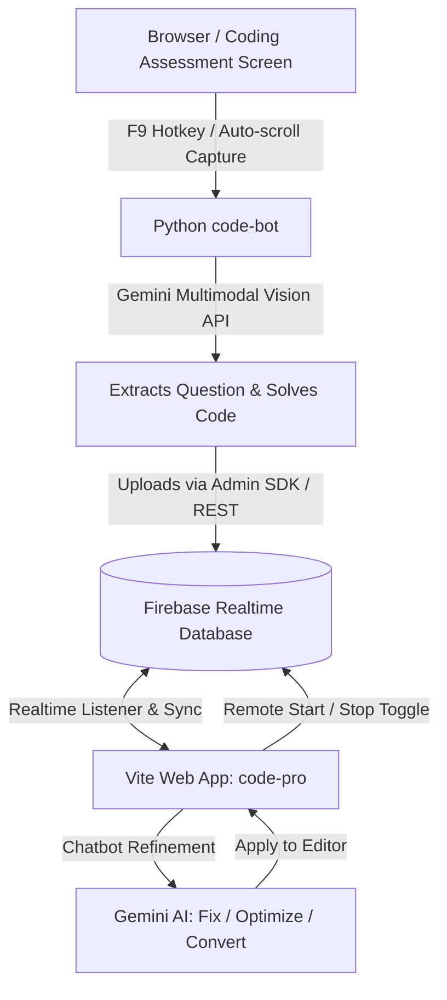

# 🚀 Code-Pro: Automated Coding Scanner, Solver & Interactive Assistant

An end-to-end automated system designed for coding platforms and online assessments (LeetCode, HackerRank, CodeChef, Mettl, etc.).

The system consists of:
1. **`code-bot/` (Python CLI Bot)**: Captures your screen, automatically scrolls down to capture long problem statements & test cases, uses Google Gemini Multimodal Vision to solve the problem, and uploads the solution to Firebase Realtime Database.
2. **`code-pro/` (Vite + React Web App)**: Real-time web dashboard that displays questions as clean single-line summaries, provides a full Monaco Code Editor with one-click copy, includes remote Start/Stop bot controls, and features an interactive AI chatbot to debug or optimize code.

---

## 🏗️ System Architecture



---

## 🌟 Key Features

* **⚡ Auto-Scroll Multi-Frame Capture**: Automatically scrolls the question panel to capture the complete problem statement, constraints, example test cases, and starter code.
* **🧠 Gemini Multimodal Vision AI**: Solves problems directly from screenshots without fragile OCR. Matches the platform's starter code template (e.g., C++, Python, Java).
* **🔑 Multi-Key Failover Rotation**: Pre-configured with automatic rotation across 5 Gemini API keys so you never hit rate limits.
* **🔥 Firebase Realtime Database Integration**: Supports both native `firebase-admin` (Service Account) and REST API fallback. Instant syncing without page reloads.
* **🛑 Remote Bot Control**: Navbar toggle button on the website lets you **Start** or **Pause** the Python bot remotely at any time.
* **💻 Monaco Code Editor**: Embedded VS Code editor (`vs-dark` theme) with language selection, instant one-click **Copy Code** button, and reset capabilities.
* **🤖 Integrated AI Assistant Chatbot**: Ask Gemini to optimize time complexity, fix potential edge cases, or convert code between languages with a 1-click **"Apply to Editor"** button.

---

## 📁 Directory Structure

```
Code-Pro/
├── README.md                                      # Comprehensive documentation
├── IMPLEMENTATION_PLAN.md                         # Architecture and implementation plan
├── .gitignore                                     # Protects credentials, node_modules, dumps
├── quipu-c6fdb-firebase-adminsdk-*.json           # Firebase Admin Service Account credentials
├── code-bot/                                      # Python CLI Bot
│   ├── bot.py                                     # Interactive CLI entrypoint
│   ├── gemini_solver.py                           # Gemini Vision solver with key failover
│   ├── screen_capture.py                          # Multi-frame auto-scrolling capture
│   ├── firebase_client.py                         # Firebase Admin SDK & REST client
│   ├── config.py                                  # API keys & model configurations
│   └── requirements.txt                           # Python dependencies
└── code-pro/                                      # Vite + React Web App
    ├── package.json
    ├── vite.config.js
    ├── index.html
    └── src/
        ├── App.jsx                                # Main layout and state coordinator
        ├── firebase.js                            # Firebase Realtime Database client
        ├── gemini.js                              # Client-side chatbot AI integration
        ├── index.css                              # Modern styling and design system
        └── components/
            ├── Navbar.jsx                         # Header with remote bot toggle
            ├── QuestionList.jsx                   # Chronological sidebar problem list
            ├── QuestionView.jsx                   # Single-line title & expandable details
            ├── CodeEditor.jsx                     # Monaco editor with copy button
            └── Chatbot.jsx                        # AI assistant with prompt chips
```

---

## 🚀 How to Run and Use

### Step 1: Start the Web App (`code-pro`)

Open a terminal in the project directory:

```powershell
cd c:\Users\skahi\Downloads\Code-Pro\code-pro
npm run dev
```

The web dashboard will be available at:
👉 **`http://localhost:5173/`**

---

### Step 2: Run the Python Bot (`code-bot`)

Open a second terminal window:

```powershell
cd c:\Users\skahi\Downloads\Code-Pro\code-bot
python bot.py
```

You will see the interactive CLI menu:
```
============================================================
      🚀 CODE-PRO AUTOMATED SCANNER & SOLVER BOT
============================================================
 * Firebase RTDB: Connected (Admin SDK)
 * Gemini API Keys: 5 configured with auto-failover
 * Remote Sync: Listening to web toggle (/bot_status)
============================================================

MAIN MENU:
Status in Firebase: 🟢 ACTIVE
 [1] Start Live Monitoring Mode (Auto-listen / Hotkey F9)
 [2] Instant Capture & Solve (3s countdown)
 [3] Test Solve Sample Screenshots (dump/Two Sum)
 [4] Toggle Bot Remote Status (On / Off)
 [5] View Questions in Firebase
 [6] Clear All Questions in Firebase
 [0] Exit
```

---

### Step 3: Solve a Coding Problem

1. **Option 1 (Recommended - Live Monitoring)**:
   * In `code-bot`, press `1` to enter **Live Monitoring Mode**.
   * Switch your browser to your coding problem tab (e.g., LeetCode).
   * Press **`F9`** on your keyboard (or press **`Enter`** in the bot terminal).
   * The bot will:
     1. Capture Frame 1 (top of problem).
     2. Move cursor to question area and scroll down.
     3. Capture Frame 2 (scrolled problem details & constraints).
     4. Send both frames to Gemini AI.
     5. Generate an optimal solution matching the starter template.
     6. Push the result to Firebase Realtime Database.
   * Look at your `code-pro` website—the new question and solution will appear **instantly in real time**!

2. **Option 2 (Instant Capture with Countdown)**:
   * In `code-bot`, press `2`.
   * You get a 3-second countdown to switch to your browser window before it captures and solves.

3. **Option 3 (Test Mode)**:
   * Press `3` to run a test on existing sample screenshots without opening a browser.

---

### Step 4: Using the Website Features

* **Single-Line Title**: The complex question text is converted into an easy-to-read single-line summary title.
* **Copy Code**: Click the **Copy Code** button above the editor to instantly copy the full code to your clipboard.
* **Remote Bot Toggle**: Use the **Start Bot / Stop Bot** button in the navbar to pause or resume the bot remotely.
* **AI Chatbot**:
  * If a platform fails a testcase or you need an alternative language, click quick chips like:
    * `⚡ Optimize Time/Space`
    * `🐞 Fix Edge Cases`
    * `🐍 Convert to Python`
    * `☕ Convert to Java`
  * Or type a custom prompt.
  * When the AI provides a new solution, click **"Apply to Editor"** to update the code in Monaco editor directly!

---

## 🔒 Security Note
* The `.gitignore` file is pre-configured to ensure service account JSON files (`*firebase-adminsdk*.json`) and private keys are never committed to version control.
